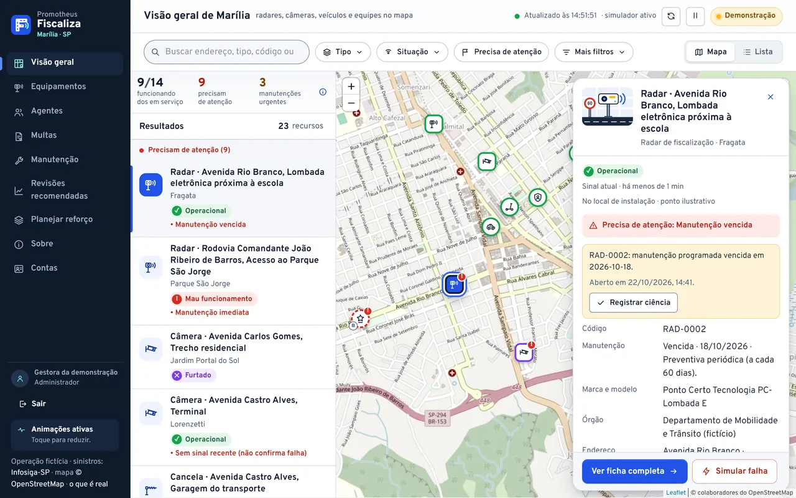
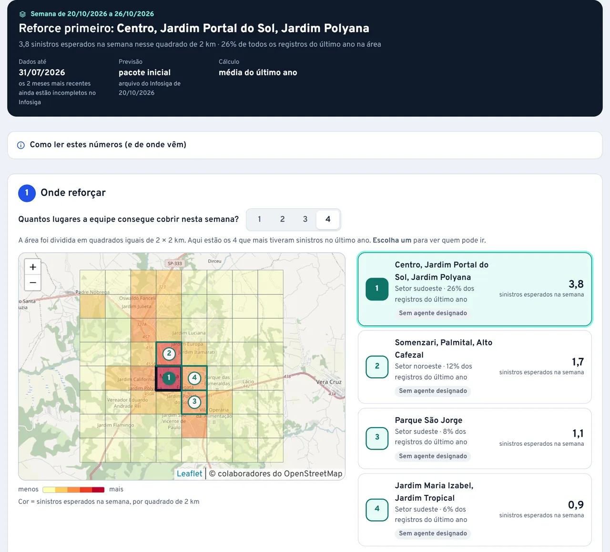

# Promotheus Fiscaliza

Central de fiscalização urbana de **Marília/SP** — inventário de equipamentos e agentes, central operacional com
mapa, análise preventiva explicável, planejamento de reforço com dados reais agregados e registro demonstrativo de
multas. Proposta para a etapa bônus **F.O.G.O.** do DSIN Coder Challenge 2026.



<sub>Captura real da aplicação com dados de demonstração, feita para a landing em 22/10/2026 (perfil compacto de então,
com 16 equipamentos e 7 agentes).</sub>

> **Demonstração com operação fictícia.** Órgãos, marcas, modelos, séries, agentes, histórico operacional, posições,
> missões e multas são sintéticos. Bairros, avenidas e CEPs de logradouro são referências geográficas públicas; os
> pontos são ilustrativos e não representam equipamentos, bases ou pessoas reais. Não há integração com prefeitura,
> polícia ou equipamentos, e nenhuma mensagem é enviada.
>
> **Exceção real:** "Planejar reforço" usa contagens **reais e agregadas** de sinistros registrados em Marília —
> Fonte: Infosiga-SP / Detran-SP, CC BY 4.0, snapshot de 20/10/2026; agregação e modelo pelo projeto Promotheus Fiscaliza.

## Comece por aqui

| Quero… | Leia |
|---|---|
| entender o projeto inteiro, de ponta a ponta | [**Manual do projeto**](docs/MANUAL-DO-PROJETO.md) |
| conhecer os termos técnicos usados aqui, com um café | [**Dicionário do Dev**](docs/DICIONARIO-DO-DEV.md) |
| usar uma tela | [Guias por funcionalidade](docs/guias/README.md) · [guia de uso rápido](docs/guia-de-uso.md) |
| instalar e rodar | [Instalação local](#instalação-local-do-zero) · [operação](docs/operacao.md) |
| saber como uma função funciona | [Referência de código](docs/referencia/codigo/README.md) · [catálogo de símbolos](docs/referencia/catalogo-simbolos.md) |
| ver o esquema do banco | [Dicionário de dados](docs/referencia/dicionario-de-dados.md) |
| conferir o que foi testado | [Verificação executada](docs/verificacao.md) · [casos de teste](docs/referencia/codigo/testes/casos.md) · [evidências](docs/evidencias/README.md) |

## O que o sistema faz

| Parte do desafio | Entregue |
|---|---|
| **1. Inventário** | Equipamentos de 7 tipos (radar, câmera, balança, cancela, totem, veículo, patinete) com **características próprias validadas por tipo** (ex.: radar com funções e limite em km/h; câmera com resolução, visão noturna, imagem colorida, PTZ); série única **por fabricante** garantida pelo banco; endereço estruturado (CEP, logradouro, referência livre, bairro, cidade/UF fixas) e local marcado no mapa; local instalado × planejado × base de recurso móvel; situação operacional; manutenção imediata ou programada/periódica com **uma intervenção em execução por vez**; arquivamento sem perder histórico nem deixar ordens sem saída. Agentes de trânsito, guarda e polícia com órgão, situação, base e **última posição separada da base**. Histórico com antes/depois, autoria e origem. — [Equipamentos](docs/guias/equipamentos.md) · [Agentes](docs/guias/agentes.md) · [Manutenção](docs/guias/manutencao.md) |
| **2. Central operacional** | "Visão geral de Marília": mapa Leaflet com ilustrações por categoria, marcadores próximos agrupados, formas distintas para instalado, planejado, base e última posição; lista com o mesmo resultado; ficha do recurso sobre o mapa (folha inferior no celular), que abre, fecha e aceita interrupção; filtros em chips com reorganização animada; avisos de sucesso/erro; realce só do que mudou a cada atualização. Três resumos (funcionando, precisam de atenção, manutenções urgentes) e os demais indicadores com fórmulas sob demanda. Busca, tipo e situação à mão; bairro, órgão e "só o que precisa de atenção" em mais filtros — tudo aplicado **ao mesmo conjunto** no servidor. Atualização por consulta a cada 5 s a partir de **eventos persistidos no Firebird** pelo simulador, sem roubar foco, fechar a seleção ou mover o mapa. Alertas com ciência e, para agentes, acompanhamento (responsável, providências, encerramento explicado). — [Visão geral](docs/guias/visao-geral.md) · [Alertas](docs/guias/alertas-e-acompanhamento.md) |
| **Multas** (pedido de 21/10/2026) | Registro **demonstrativo e manual** de infrações ([ADR-0017](docs/adr/0017-aba-multas.md)): rascunho → registro após conferência → cancelamento interno com motivo; código interno separado do AIT externo; origem por **radar do inventário** (com agente operador opcional) ou **agente de trânsito**, com retrato da origem gravado no registro; veículo autuado separado das viaturas, placa e **RENAVAM com zeros preservados** (ausência justificada); **conferência documental temporal** (na ocorrência × posterior; "Não verificada" é legítimo; corrigir a identidade pede nova conferência); etapa, pagamento e contestação independentes, sem cálculo jurídico; histórico próprio só de acréscimo, versão contra perda de edição e envio repetido sem duplicar. Lista com três resumos do mesmo filtro; tudo funciona sem JavaScript. Nada consulta Detran/Senatran, emite, cobra ou protocola. — [Multas](docs/guias/multas.md) |
| **3. Cidade preditiva** | "Revisões recomendadas para os próximos 7 dias": o que revisar primeiro, por quê e o que fazer, com prioridade heurística explicável (falhas recentes, propensão em 180 dias, atraso da preventiva). Cada corte do passado usa só o que o sistema já sabia. Limiar escolhido numa janela de **ajuste** e medido numa janela de **avaliação** posterior, contra uma referência simples. Em cinco sementes inéditas, o índice concentra falhas cerca de 2× acima do acaso com menos alertas que a referência ([método e números](docs/analise-preventiva.md)).<br>**Planejar reforço**: contagem esperada de sinistros registrados na semana com histórico **real** agregado do Infosiga-SP; média simples das 52 semanas (um Poisson experimental foi testado e ficou fora da tela); de 1 a 4 **quadrados de 2 km** onde concentrar o reforço (no teste de 2026, 4 quadrados pegaram 51% dos registros contra 40% do setor inteiro); sugestão de agente de trânsito livre; missão fictícia confirmada pelo gestor, com reserva atômica; retrospecto semana a semana do teste de 2025 com a previsão congelada antes do resultado ([método e resultados](docs/planejamento-por-setores.md)). — [Revisões](docs/guias/revisoes-recomendadas.md) · [Planejar reforço](docs/guias/planejar-reforco.md) |



<sub>Planejar reforço — captura real de 22/10/2026 (semana de 20 a 26/10/2026, dados até 31/07/2026).</sub>

## Stack

Versões declaradas nos manifestos, lockfiles e na imagem (conferidas em 26/10/2026; fbclient medido na
[prova de 18/10/2026](docs/evidencias/2026-10-18-prova-firebird.md)):

PHP **8.5.11** · Slim **4.15.3** · Twig **3.30.0** · **Firebird 5.0.4** via PDO_FIREBIRD (fbclient 4.0.5) · Leaflet **1.9.4**
(local) · interface com **Tailwind CSS 4.3.3**, **Alpine.js 3.17.4 (build CSP)**, **GSAP 3.15.0** (Flip; SplitText e
CustomWiggle no cartão de autoria) e **Vite 8.3.2** — o build fica versionado em `public/assets/build/`, então a produção
não precisa de Node ([ADR-0012](docs/adr/0012-identidade-motion-e-build-de-assets.md)) · Apache 2.4 (imagem
`php:8.5.11-apache-trixie`) · PHPUnit 12.5 · PHPStan 2.3 (nível 6) · PHP-CS-Fixer 3.95 (PER Coding Style) · three.js
0.186.1 só na landing. Sem ORM: PDO direto com SQL Firebird em repositórios pequenos
([ADR-0002](docs/adr/0002-pdo-direto-sem-orm.md)). Tabela completa: [implantação e CI](docs/referencia/implantacao-e-ci.md#versões-declaradas).

## Instalação local (do zero)

Pré-requisitos: **Docker** com Compose v2 e **Git**. Nada mais precisa estar instalado no computador.

```bash
git clone <URL-DO-REPOSITÓRIO> promotheus-fiscaliza
cd promotheus-fiscaliza
cp .env.example .env
```

Edite o `.env` e troque os três valores `troque-…` (`DB_PASSWORD`, `DB_MIGRATION_PASSWORD`, `FIREBIRD_ROOT_PASSWORD`)
por senhas longas e aleatórias (letras e números). Depois:

```bash
docker compose up -d --build
docker compose exec app composer install
docker compose exec app php bin/fiscaliza migrate
docker compose exec app php bin/fiscaliza demo:seed
docker compose exec app php bin/fiscaliza user:create avaliador --role=ADMIN --name="Avaliador"
docker compose exec app php bin/fiscaliza urban:import
docker compose exec app php bin/fiscaliza urban:update
docker compose --profile simulador up -d simulator
docker compose --profile atualizador up -d atualizador
```

`demo:seed` carrega o perfil **compacto** (17 equipamentos e 7 agentes que cobrem todas as categorias e situações);
`demo:seed --perfil=completo` carrega os 48 e 21 usados na metodologia ([ADR-0013](docs/adr/0013-perfil-compacto-de-demonstracao.md)).
O comando `user:create` mostra **uma única vez** a senha gerada. Abra
<http://localhost:8080/promotheusfiscaliza/> e entre com essa conta. **Não há acesso sem conta**: nenhuma tela, mapa
ou API responde a visitantes, e não existe cadastro aberto — o administrador cadastra cada pessoa em **Contas** (ou
pelo `user:create` no servidor) e entrega a senha gerada ([ADR-0014](docs/adr/0014-acesso-somente-com-conta-cadastrada.md)).
A raiz <http://localhost:8080/> serve a **landing pública** do projeto ([landing/README.md](landing/README.md)); a
aplicação continua restrita ao prefixo. Banco já existente de uma versão anterior: rode `migrate` de novo (aplica as
migrações pendentes; ver [operação](docs/operacao.md#atualizar-um-banco-existente-para-a-migração-0002) e
[migrações](database/migrations/README.md)).

`urban:update` acessa a internet (arquivo mensal do Infosiga-SP) e o cadastro de agentes consulta ViaCEP e Nominatim
(só o CEP ou o nome da rua saem). Sem internet, o resto funciona.

Testes, análise estática e estilo (usam o banco de testes `fiscaliza_test.fdb`, **apagado e recriado** a cada execução;
os testes recusam rodar se o banco de testes for o mesmo do `DB_DSN`):

```bash
docker compose exec app vendor/bin/phpunit
docker compose exec app vendor/bin/phpstan analyse --memory-limit=512M
docker compose exec app vendor/bin/php-cs-fixer fix --dry-run --diff
```

Mudar o visual ou os scripts da interface (só para desenvolvimento): `npm ci && npm run build` (Node 20.19+), ou
`docker run --rm -v "$PWD":/app -w /app node:22-bookworm sh -c "npm ci && npm run build"`. Fontes em `resources/`.

Problemas comuns: as senhas do `.env` são lidas pelo Firebird **só na primeira criação do volume**; se mudá-las
depois, recrie com `docker compose down -v` (apaga o banco local). Porta 8080 ocupada: defina `APP_PORT` no `.env`.

## Roteiro rápido de avaliação

1. Entre com a conta criada pelo `user:create` (sem conta, qualquer endereço leva ao login). Visão geral: leia os
   três resumos (ⓘ abre as fórmulas), use os chips **Tipo**, **Situação** e **Precisa de atenção**, escolha o radar da
   Av. Sampaio Vidal na lista ou no mapa (a ficha abre ao lado) e alterne entre Mapa e Lista com a mesma seleção; no
   celular, use o botão de menu. O botão **Animações** no menu mostra se o movimento está reduzido e por quê.
2. Ficha de um equipamento: próxima ação, onde está, cadastro, manutenção e histórico (tracejado = registro que não
   alterou a situação, com o motivo).
3. Em **Contas**, cadastre uma pessoa e confira, numa janela anônima, que ela só entra depois desse cadastro. Depois
   cadastre um radar (deixe "Velocidade" sem limite para ver o resumo de erros com a digitação mantida), instale-o
   (Não instalado → Operacional), inicie e conclua uma ordem (tente iniciar outra do mesmo equipamento), use
   **Simular falha** e registre ciência do alerta — ele só resolve quando a causa some. Na ficha do agente Hermes 06
   (em turno sem posição recente), registre ciência, atribua o acompanhamento à conta que você cadastrou, registre uma
   providência com a próxima conferência e use **Mais ações → Simular recebimento de posição** para ver o encerramento
   explicado ([ADR-0022](docs/adr/0022-acompanhamento-dos-alertas-de-agentes.md)).
4. Revisões recomendadas: o que revisar e por quê; abra o método e o retrospecto com a referência.
5. Planejar reforço: leia período, data dos dados e origem de cada camada; siga os três passos (onde reforçar, quem
   enviar, confirmar); confirme a missão fictícia sugerida; abra **Retrospecto da previsão**, escolha uma semana, veja a
   previsão congelada e só então **Revelar o que aconteceu**.
6. Multas: filtre por origem, abra o rascunho e veja o que falta; abra o registro com pagamento informado e recurso em
   análise; na multa retificada, compare a conferência antiga (só no histórico) com a ficha "Não verificada"; cadastre
   um rascunho por Radar e por Agente (troque a origem e volte: a digitação continua) e registre uma conferência.

Comandos úteis: `php bin/fiscaliza` lista os comandos (`sim:tick` para cron, `analysis:run`, `demo:seed --reset`,
`demo:seed-multas` — acrescenta as multas a uma demonstração existente sem apagar nada, `urban:import`, `urban:update` —
download mensal do Infosiga e previsão semanal automáticos) — [console](docs/referencia/codigo/cli/console.md). O treino
do planejamento por setores roda fora da aplicação, em `ml/` (Python; ver [ml/README.md](ml/README.md)).

## Estado da entrega

| Situação | Itens |
|---|---|
| **Implementado e verificado** | Partes 1, 2 e 3 descritas acima; identidade de trânsito, movimento e perfil compacto com capturas, vídeos e verificação no navegador ([evidência](docs/evidencias/2026-10-18-identidade-e-motion.md)); acesso somente com conta cadastrada pelo administrador ([ADR-0014](docs/adr/0014-acesso-somente-com-conta-cadastrada.md), [evidência](docs/evidencias/2026-10-19-identidade-com-acesso-por-conta.md)); cartão de autoria animado na página Sobre ([evidência](docs/evidencias/2026-10-19-cartao-de-autoria.md)); landing pública na raiz com a marca montada em 3D (Three.js + GSAP), capturas reais e seção "Para o avaliador" com o vídeo de apresentação ([ADR-0015](docs/adr/0015-landing-publica-e-marca-3d.md), [evidência](docs/evidencias/2026-10-20-landing-publica.md)), atualizada em 22/10/2026 com os seis pilares, capturas com recorte de celular e foto de Marília atrás da marca ([ADR-0018](docs/adr/0018-landing-seis-pilares-e-foto-de-marilia.md), [evidência](docs/evidencias/2026-10-22-landing-atualizada.md)); planejamento preventivo por setores com contagens reais do Infosiga-SP, missões fictícias e retrospecto ([ADR-0016](docs/adr/0016-planejamento-preventivo-por-setores.md), [evidência](docs/evidencias/2026-10-20-planejar-reforco.md)); aba Multas com migração em banco existente, cenário não destrutivo e verificação no navegador ([ADR-0017](docs/adr/0017-aba-multas.md), [evidência](docs/evidencias/2026-10-21-multas.md)); prova PHP/Firebird ([evidência](docs/evidencias/2026-10-18-prova-firebird.md)); testes automatizados (unidade, integração no Firebird real, HTTP, concorrência com processos separados) — **última execução registrada: 283 testes, 1914 asserções, OK, em 24/10/2026** ([verificação](docs/verificacao.md)); revisão de lógica e fluxos de 24/10/2026 ([ADR-0023](docs/adr/0023-revisao-de-logica-e-fluxos.md), [evidência](docs/evidencias/2026-10-24-revisao-logica-e-fluxos.md)); correções dos achados da auditoria de 18/10/2026 ([evidência](docs/evidencias/2026-10-18-correcoes-da-auditoria.md)); backup e restauração com gbak ([evidência](docs/evidencias/2026-10-18-backup-restauracao.md)); origem dedicada testada localmente. Rastreabilidade: [matriz de requisitos](docs/matriz-requisitos.md). |
| **Auditoria de 25/10/2026** | Correções A01–A03 e A05–A12 (commit `35de711`), com novos casos de teste de concorrência e regras (`AccountsTest`, `Interleaving` e outros) e verificação de interface em `scripts/verificacao-interface/auditoria.cjs`; a próxima execução da suíte completa será registrada em [verificação](docs/verificacao.md). |
| **Pendente (depende do proprietário/infra)** | Repositório público (GitLab/GitHub) e varredura de segredos no histórico antes do primeiro push; ZIP de entrega gerado a partir do commit final; conferência das condições finais da DSIN; teste com leitor de tela e com pessoa iniciante; conferir os termos da licença do GSAP; revisar as telas com o mapa de fundo real (as evidências foram gravadas sem tiles). Publicação: ver abaixo. |
| **Fora do escopo** | Integração real com IoT/órgãos, consulta oficial, emissão, cobrança ou protocolo de multas, reconhecimento de placas/faces, geolocalização de pessoas reais, app nativo, mensageria, alta disponibilidade e exportações. (O 3D existe só como decoração da landing; o "mapa de calor" de Planejar reforço é a grade de quadrados de 2 km.) |

## Publicação

A hospedagem compartilhada do portal não oferece servidor Firebird nem `pdo_firebird` com garantia, e uma subpasta
compartilha a **mesma origem** do portal. A proposta (VPS/contêiner em origem dedicada com `compose.origem-dedicada.yaml`,
e o caminho do portal redirecionando para ela) e a alternativa com proxy e prefixo estão em
[operação](docs/operacao.md#publicação) e [segurança](docs/seguranca.md#publicação-e-limite-de-mesma-origem). Esvaziar
`APP_BASE_PATH` sozinho não basta: o Apache padrão serve a aplicação só sob o prefixo. Para levar uma instalação que já
está no ar para esta versão (backup, `git pull`, contêineres, conta de administrador), siga
[Atualizar uma instalação publicada](docs/operacao.md#atualizar-uma-instalação-publicada).

Endereços: a configuração da landing usa `https://fiscaliza.devfelipegomes.com.br/` como URL pública, e o
[README da landing](landing/README.md#publicação-no-servidor-atual) registra em 19–20/10/2026 que esse subdomínio é
servido pelo contêiner deste projeto (landing na raiz, aplicação em `/promotheusfiscaliza/`). O endereço pretendido
inicialmente era `https://devfelipegomes.com.br/promotheusfiscaliza`.

## Documentação

- [Manual do projeto](docs/MANUAL-DO-PROJETO.md) — visão de ponta a ponta
- [Guias por funcionalidade](docs/guias/README.md) · [guia de uso rápido](docs/guia-de-uso.md)
- [Arquitetura](docs/arquitetura.md) · [referência de código](docs/referencia/codigo/README.md) · [catálogo de símbolos](docs/referencia/catalogo-simbolos.md)
- [Domínio e indicadores](docs/dominio.md) · [dicionário de dados](docs/referencia/dicionario-de-dados.md)
- [Rotas HTTP, permissões e contratos de escrita](docs/http.md)
- [Análise preventiva](docs/analise-preventiva.md) · [Planejar reforço por setores](docs/planejamento-por-setores.md) · [dados e ML](ml/README.md)
- [Segurança e privacidade](docs/seguranca.md)
- [Operação](docs/operacao.md) · [implantação, configuração e CI](docs/referencia/implantacao-e-ci.md)
- [Verificação executada](docs/verificacao.md) · [matriz de requisitos](docs/matriz-requisitos.md) · [evidências](docs/evidencias/README.md)
- [Landing pública](landing/README.md) · [vídeo de apresentação](video/README.md)
- [Decisões (ADRs)](docs/adr/README.md)
- [IA e autoria](docs/ia-e-autoria.md) · [licenças e fontes](docs/licencas-e-fontes.md) · [roteiro do vídeo](docs/roteiro-video.md)
- [Cobertura desta documentação](docs/cobertura-documentacao.md) · [índice de `docs/`](docs/README.md)
- Planejamento original recebido: [docs/planejamento-codex-2026-10-18](docs/planejamento-codex-2026-10-18/00-LEIA-PRIMEIRO.md)

## Uso de IA

Planejamento, auditoria e o treino/dados do planejamento por setores: Codex (OpenAI). Implementação, integração,
correções e esta documentação: Claude (Anthropic), modelo Opus 5.5, no Claude Code. Revisão, decisões e
responsabilidade: autor do projeto. Detalhes em [IA e autoria](docs/ia-e-autoria.md).

## Licença

Código sob [licença MIT](LICENSE); a foto do autor (`public/assets/img/autor/`) e a foto de Marília da landing (© Pedro
Monteiro) não estão incluídas nela. Leaflet (BSD-2-Clause), Alpine.js e Tailwind CSS (MIT), GSAP (licença "Standard 'no
charge'" da GreenSock, não MIT — termos a conferir antes de publicar), three.js (MIT, só na landing), fonte Overpass (SIL
OFL 1.1), dados do OpenStreetMap (ODbL) e contagens do Infosiga-SP/Detran-SP (CC BY 4.0) mantêm suas licenças — ver
[licenças e fontes](docs/licencas-e-fontes.md).
