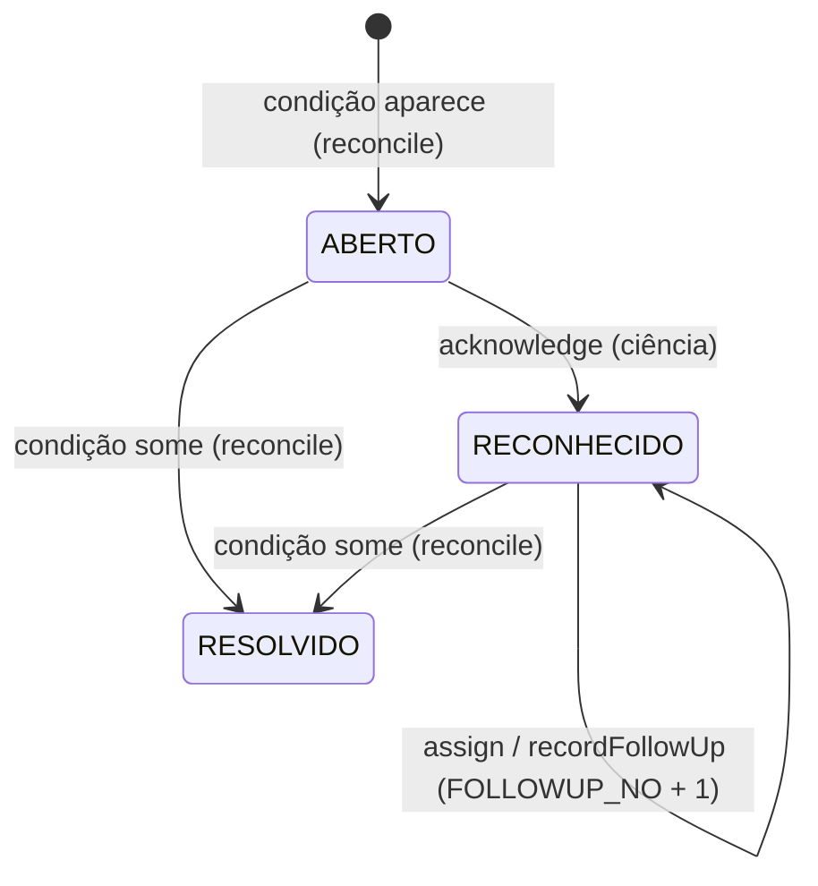

# Alertas: reconciliação, ciência e acompanhamento

<!-- fontes: src/Application/AlertService.php -->

`AlertService` mantém os alertas coerentes com as **condições atuais** e registra o trabalho humano sobre eles:
**ciência**, **responsável** (uma conta ativa de `APP_USER`) e **providências**. Nada disso resolve a causa: o alerta
só encerra quando a condição some ([ADR-0022](../../../adr/0022-acompanhamento-dos-alertas-de-agentes.md)).

Guia: [Alertas e acompanhamento](../../../guias/alertas-e-acompanhamento.md).

## `AlertService`

Dependências: `Database`, `AlertRepository`, `EquipmentRepository`, `AgentRepository`, `MaintenanceRepository`,
`UserRepository`, `Clock`.

### `AlertService::reconcile`

`reconcile(): array{opened: int, resolved: int}` — deve rodar **dentro da transação que mudou o estado** (todos os
serviços de escrita e o simulador a chamam).

1. Lê equipamentos e agentes ativos e as ordens abertas e calcula as condições com
   [`AlertRules::conditions`](../domain/indicadores-e-alertas.md#alertrulesconditions).
2. Para cada condição nova (chave ausente entre os não resolvidos) insere um alerta `ABERTO` com `OPEN_KEY`. Se outro
   processo abriu o mesmo alerta no mesmo instante, o índice único `UQ_ALERT_OPEN_KEY` recusa e a inserção é contada
   como já existente.
3. Para cada alerta não resolvido cuja condição sumiu: `RESOLVIDO`, `OPEN_KEY = NULL`, `RESOLVED_AT` e
   `RESOLVED_REASON` por [`AlertRules::resolutionReason`](../domain/indicadores-e-alertas.md#alertrulesresolutionreason).

Idempotente: duas execuções seguidas não criam duplicatas. Testes: `OperationsTest` (ciclo idempotente e concorrente),
`AlertFollowUpTest`.

### `AlertService::acknowledge`

`acknowledge(int $alertId, int $userId, ?string $note): void` — registra ciência (`RECONHECIDO`, `ACK_AT`, `ACK_BY`,
nota opcional cortada em 300). Só alerta `ABERTO`; resolvido → `RuleViolation` "já foi resolvido: a causa deixou de
existir"; reconhecido → "já foi reconhecido". Usado pela central (equipamentos e agentes) e pela ficha do agente. Não
atribui responsável nem encerra.

### `AlertService::assign`

`assign(int $alertId, array $data, int $userId): void` — atribui ou reatribui o acompanhamento.

| Chave | Regra |
|---|---|
| `assignee` | ID de conta (inteiro ≥ 1); vazio → "Escolha a conta responsável…" |
| `version` | `FOLLOWUP_NO` lido pela ficha |

Transação: [`pending`](#alertservicepending) (alerta não resolvido, travado, na versão lida); mesma conta →
`ValidationFailed`; conta inexistente ou desativada → `ValidationFailed` ("Esta conta não está ativa"); grava
`ASSIGNEE_ID` e incrementa `FOLLOWUP_NO`; acrescenta `ALERT_FOLLOWUP` do tipo `ATRIBUICAO` (de → para, quem, quando).
Independe da ciência.

### `AlertService::recordFollowUp`

`recordFollowUp(int $alertId, array $data, int $userId): void` — providência feita **por outro meio** (o sistema não
envia mensagem).

| Chave | Regra |
|---|---|
| `action` | `CONTATO_TENTADO`, `CONTATO_CONFIRMADO`, `COMUNICACAO_VERIFICADA`, `OUTRA` |
| `note` | até 500; obrigatório em `OUTRA` |
| `next_check` | `AAAA-MM-DDTHH:MM` em hora de Marília, depois de agora e em até 7 dias; vazio = sem conferência |
| `version` | `FOLLOWUP_NO` lido |

Transação: `pending`; alerta ainda `ABERTO` → `RuleViolation` "Registre a ciência antes de registrar providências.";
grava a próxima conferência (substitui a anterior), incrementa `FOLLOWUP_NO` e acrescenta `ALERT_FOLLOWUP`
`PROVIDENCIA`. Os registros anteriores ficam (a aplicação só lê e insere em `ALERT_FOLLOWUP`).

### `AlertService::pending`

`private pending(int $alertId, mixed $version): array` — trava o alerta (`WITH LOCK`); resolvido → `RuleViolation`
"Este alerta foi encerrado em … enquanto você preenchia o formulário." com o motivo; versão diferente de
`FOLLOWUP_NO` → `ConcurrencyConflict` "O acompanhamento deste alerta mudou depois que você abriu a ficha…". A ficha
reapresenta o formulário com o que foi digitado.

| Método | Contrato |
|---|---|
| `AlertService::__construct` | dependências acima. |
| `AlertService::eligible` | `private (int $userId): void` — só conta ativa recebe atribuição nova; o vínculo de uma conta desativada depois continua no histórico (a ficha mostra "conta desativada: reatribua"). |
| `AlertService::accountId` | `private (mixed $value, array &$errors): ?int` — valida o ID da conta. |
| `AlertService::nextCheck` | `private (mixed $value, array &$errors): ?string` — valida a próxima conferência (formato com ida e volta, depois de agora, até `MAX_CHECK_DAYS`) e converte para UTC. |

Testes: `AlertFollowUpTest` (ciência sem resolver nem atribuir; providência só depois da ciência; conta recém-cadastrada
atribuída e reatribuída; conta desativada; versão antiga → conflito; posição nova, antiga e fora de ordem; saída de
turno; pendência antiga além dos 20 encerrados), `AgentsHttpTest` (404, 422 e 409 mantendo a digitação).

## Relacionados

[Regras de alerta](../domain/indicadores-e-alertas.md) · [Repositório de alertas](../infrastructure/repositorios-operacao.md#alertrepository) ·
[HTTP: alertas](../../../http.md#alertas-análise-contas-e-login)
