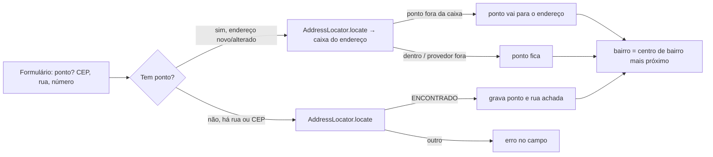

# Endereço: rua pelo CEP, ponto pela rua e bairro pelo ponto

<!-- fontes: src/Application/AddressLocator.php src/Application/AddressPoint.php src/Application/CepAddress.php src/Application/CepLookup.php src/Application/Geocoder.php -->

Regras do local nos cadastros de **equipamento** e de **base de agente**
([ADR-0021](../../../adr/0021-base-do-agente-pelo-mapa-e-rua-pelo-cep.md)). Latitude e longitude **nunca são
digitadas**: vêm do clique no mapa ou, sem ele, do endereço (rua informada ou rua do CEP, localizada pelo provedor). O
bairro é sempre derivado do ponto. As interfaces `CepLookup` e `Geocoder` isolam os provedores externos
([ViaCEP e Nominatim](../infrastructure/provedores-externos.md)); os testes usam falsos e nunca a rede.

## `CepAddress`

Endereço de um CEP como o provedor devolveu (`final readonly`: `cep`, `street`, `district`, `city`, `uf`). Só a rua (e
o CEP) podem ir para um cadastro; o resto serve à tela.

| Método | Contrato |
|---|---|
| `CepAddress::__construct` | `(string $cep, string $street, string $district, string $city, string $uf)`. |
| `CepAddress::isInMarilia` | `(): bool` — `uf === 'SP'` e cidade `marília` (minúsculas, com acento). CEP de outra cidade não preenche a rua. |

## `CepLookup` (interface)

`CepLookup::find(string $cep): ?CepAddress` — `$cep` já validado (`00000-000`). Devolve `null` quando o provedor diz que
o CEP não existe; lança [`ProviderUnavailable`](../erros.md) quando não responde a tempo, falha ou responde fora do
formato. Implementação: `ViaCepClient`; teste: `FakeCepLookup`.

## `Geocoder` (interface)

`Geocoder::locate(string $street): ?array` — ponto de uma rua de Marília/SP: `{lat, lng}` como texto com 6 casas e,
se o provedor der, `box` = retângulo do lugar `[sul, norte, oeste, leste]`; `null` se não achado; `ProviderUnavailable`
em falha. Implementação: `NominatimGeocoder`; teste: `FakeGeocoder`.

## `AddressLocator`

| Símbolo | Contrato |
|---|---|
| `AddressLocator::MESSAGES` | texto pronto de cada situação: `ENCONTRADO` ("Ponto posto no endereço (aproximado)…"), `SEM_RUA`, `NAO_ENCONTRADO`, `INDISPONIVEL`. |
| `AddressLocator::__construct` | `(CepLookup $cep, Geocoder $geocoder)`. |
| `AddressLocator::locate` | ver abaixo. |

### `AddressLocator::locate`

`locate(?string $street, ?string $cep, ?string $number = null): array`

1. Sem rua e com CEP: consulta o CEP; a rua só vale se o CEP for de Marília (`isInMarilia`).
2. Ainda sem rua → `['situacao' => 'SEM_RUA']`.
3. Com número cujos dígitos iniciais existam (`"1200 fundos"` → `1200`): tenta primeiro `"1200 <rua>"`; o mapa nem
   sempre tem números, então cai para a rua.
4. `ProviderUnavailable` em qualquer consulta → `INDISPONIVEL` (registra no log privado, **sem** a rua nem o CEP).
5. Nada achado → `NAO_ENCONTRADO`.
6. Achado → `{situacao: ENCONTRADO, lat, lng, rua, caixa}`. A **caixa** é a área do endereço: com a casa achada pelo
   número, ±0,0015° (≈150 m) em volta; só com a rua, o retângulo devolvido pelo provedor com folga de 0,001° (≈100 m).

Quem chama: [`AddressController::locate`](../http/controladores.md#addresscontroller) (`GET /api/localizar`) e
[`AddressPoint`](#addresspoint). Testes: `AddressLocatorTest`.

## `AddressPoint`

Ponto de um cadastro com endereço. Os nomes dos campos variam por formulário e chegam em `$fields`:
equipamento `['lat' => 'lat', 'lng' => 'lng', 'street' => 'street', 'cep' => 'cep', 'number' => 'address_ref']`;
agente `['lat' => 'base_lat', 'lng' => 'base_lng', 'street' => 'base_street', 'cep' => 'base_cep', 'number' => 'base_ref']`.

| Método | Contrato |
|---|---|
| `AddressPoint::__construct` | `(\Closure $locator, ReferenceRepository $references)` — o localizador vem como *closure* e só é criado se for preciso consultar. |
| `AddressPoint::resolve` | ver abaixo. |
| `AddressPoint::regionOnUpdate` | `(array $current, array $values, string $latKey, string $lngKey): array` — na edição, o bairro acompanha o ponto: devolve `['region_id' => …]` se o ponto mudou (comparando com 6 casas) ou se ainda não havia bairro; senão `[]` (fica o gravado, inclusive o escolhido à mão em cadastros antigos). |
| `AddressPoint::regionAt` | `(float $lat, float $lng): ?int` — ID do bairro de centro mais próximo ([`NearestRegion`](../domain/setores-e-regioes.md#nearestregion)). |
| `AddressPoint::addressChanged` | `private static (?array $current, array $values, array $keys): bool` — rua, CEP ou número diferentes do gravado (ou cadastro novo). |
| `AddressPoint::keepInsideAddress` | `private (array &$values, array $fields): void` — localiza o endereço e, se o ponto estiver fora da caixa, troca pelo ponto do endereço; provedor fora do ar ou endereço não achado: mantém o ponto. |

### `AddressPoint::resolve`

`resolve(Input $input, array &$values, ?array $current, array $fields, string $what): void` — chamado no fim da
validação de equipamento/agente, **fora de transação** e só com o resto do formulário válido (consulta externa não
acontece para um formulário que já vai voltar com erro).

- Erro já registrado em lat/lng → não faz nada.
- Ponto presente: se não houver outros erros, houver rua e o endereço for novo ou alterado → `keepInsideAddress`.
- Só lat **ou** só lng, ou nem ponto nem endereço → erro em lat: "Marque {o local|a base} no mapa ou, sem o mapa,
  informe o CEP e a rua.".
- Sem ponto e com rua/CEP → `AddressLocator::locate`; `ENCONTRADO` grava lat, lng e a rua achada (a rua do CEP passa a
  ser a rua gravada); `INDISPONIVEL` → erro em lat; `SEM_RUA`/`NAO_ENCONTRADO` → erro na rua, com a mensagem de
  `MESSAGES`.

Testes: `AgentBaseTest`, `EquipmentLocationTest`, `AgentsHttpTest` (sem login não há chamada externa; entrada inválida
validada antes; provedor fora do ar mantém a digitação).

## Relacionados

[Provedores externos](../infrastructure/provedores-externos.md) · [HTTP: `/api/cep` e `/api/localizar`](../../../http.md#consulta-de-cep-get-apicepcep) ·
[Guia: Agentes](../../../guias/agentes.md#base-de-trabalho-mapa-cep-e-rua)
