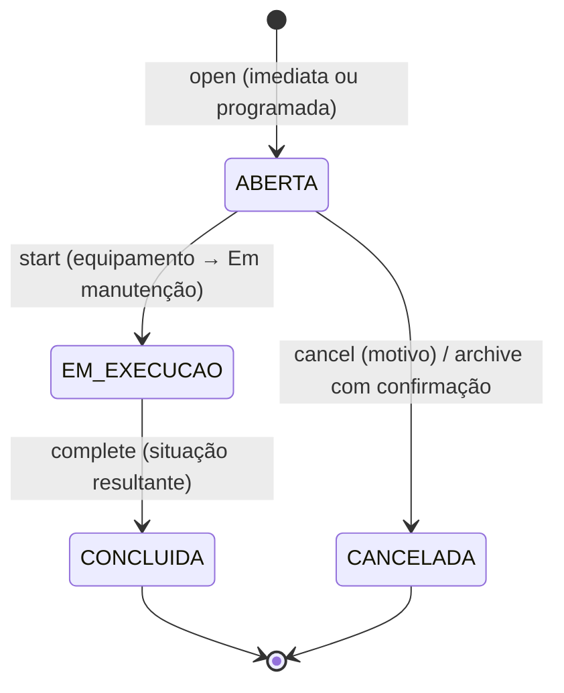

# Ordens de manutenção

<!-- fontes: src/Application/MaintenanceService.php -->

Ciclo de vida das ordens: `ABERTA → EM_EXECUCAO → CONCLUIDA`, ou `ABERTA → CANCELADA`
([ADR-0009](../../../adr/0009-uma-intervencao-por-vez-e-arquivamento-explicito.md)).

Regras:

- **Agendar não tira o equipamento de operação**; **iniciar** a intervenção o coloca "Em manutenção".
- **Uma intervenção em execução por equipamento**: verificada no serviço e garantida pelo índice único parcial
  `UX_MAINT_ONE_RUNNING` (`MAINTENANCE_ORDER(EQUIPMENT_ID)` onde `STATE = 'EM_EXECUCAO'`). Duas intervenções simultâneas
  tornariam ambíguo o resultado (a primeira a terminar liberaria o equipamento).
- **Concluir exige declarar a situação resultante** (operacional, ainda em falha ou desativado): concluir não prova que o
  equipamento voltou a funcionar.
- Concluir uma **preventiva** de equipamento com periodicidade agenda a próxima.
- Ordem de bloqueio fixa: **equipamento, depois a ordem** — também no arquivamento e na abertura — para que operações
  concorrentes sobre o mesmo equipamento se enfileirem em vez de travarem umas às outras.

Rotas: [`OperationsController`](../http/controladores.md#operationscontroller). Guia: [Manutenção](../../../guias/manutencao.md).

## `MaintenanceService`

Dependências: `Database`, `MaintenanceRepository`, `EquipmentRepository`, `EquipmentService` (para `applyStatus`),
`History`, `AlertService`, `Clock`.

### `MaintenanceService::open`

`open(int $equipmentId, array $data, ?int $actorId, string $source = 'MANUAL'): int`

| Campo | Regra |
|---|---|
| `kind` | `CORRETIVA` ou `PREVENTIVA` |
| `priority` | `IMEDIATA` ou `PROGRAMADA` |
| `due_date` | obrigatória se programada; com origem `MANUAL`, não pode estar no passado (data local) |
| `reason` | obrigatório, até 300 |

Transação: bloqueia o equipamento; arquivado → `RuleViolation`; insere a ordem `ABERTA` com autoria e origem; evento
`MANUTENCAO_ABERTA`; reconcilia alertas (imediata abre `MANUTENCAO_IMEDIATA`). A situação **não** muda. Agendar é
permitido mesmo em situação que impede o início (não instalado, desativado, furtado).

### `MaintenanceService::start`

`start(int $orderId, ?int $actorId, string $source = 'MANUAL'): void`

Transação: `lockOrder` (equipamento → ordem). Recusa com `RuleViolation` se a ordem não estiver `ABERTA`, se o
equipamento estiver arquivado, se a situação tiver [`maintenanceStartBlocker`](../domain/situacoes-e-atualidade.md#equipmentstatusmaintenancestartblocker)
("A ordem #N continua agendada. …") ou se outra ordem do mesmo equipamento estiver em execução ("A ordem #M já está em
execução neste equipamento. Conclua-a…"). Marca `EM_EXECUCAO` (`STARTED_AT`); se o índice único disparar mesmo assim,
vira a mesma `RuleViolation`. Aplica `MANUTENCAO` pela tabela de transições, grava `MANUTENCAO_INICIADA` e reconcilia.

### `MaintenanceService::complete`

`complete(int $orderId, array $data, ?int $actorId, string $source = 'MANUAL'): ?int` — devolve o ID da próxima
preventiva agendada, se houver.

- `resolution` obrigatório (≤ 500); `result_status` ∈ `OPERACIONAL`, `FALHA`, `DESATIVADO`.
- Transação: ordem precisa estar `EM_EXECUCAO` ("Inicie a intervenção antes de concluí-la"). Fecha como `CONCLUIDA`
  com o resultado; aplica a situação informada (concluir em `FALHA` é aceito: "continua com mau funcionamento");
  evento `MANUTENCAO_CONCLUIDA`.
- Preventiva + periodicidade > 0 + resultado ≠ `DESATIVADO` + nenhuma outra preventiva aberta → nova ordem
  `PREVENTIVA`/`PROGRAMADA` para **hoje local + intervalo**, origem `SISTEMA`, sem autor, com evento próprio.
- Reconcilia alertas.

### `MaintenanceService::cancel`

`cancel(int $orderId, string $reason, int $actorId): void` — motivo obrigatório (≤ 500); só ordem `ABERTA` ("uma
intervenção iniciada deve ser concluída com o resultado real"); fecha como `CANCELADA` com o motivo em `RESOLUTION`,
evento `MANUTENCAO_CANCELADA`, reconciliação.

| Método | Contrato |
|---|---|
| `MaintenanceService::__construct` | dependências acima. |
| `MaintenanceService::lockOrder` | `private (int $orderId): array{0: ordem, 1: equipamento}` — descobre o equipamento da ordem, bloqueia o equipamento e depois a ordem; inexistentes → `NotFound`. |
| `MaintenanceService::alreadyRunning` | `private static (?int $orderId): RuleViolation` — mensagem de "já em execução". |

Concorrência comprovada com processos separados: `MaintenanceInvariantsTest` (duas tentativas de iniciar ordens do
mesmo equipamento ao mesmo tempo → uma vale; pendência antiga além de 31 encerradas continua acessível), `OperationsTest`.

## Relacionados

[Repositórios de operação](../infrastructure/repositorios-operacao.md#maintenancerepository) ·
[HTTP: manutenção](../../../http.md#manutenção) · [Equipamentos](equipamentos.md#equipmentserviceapplystatus)
