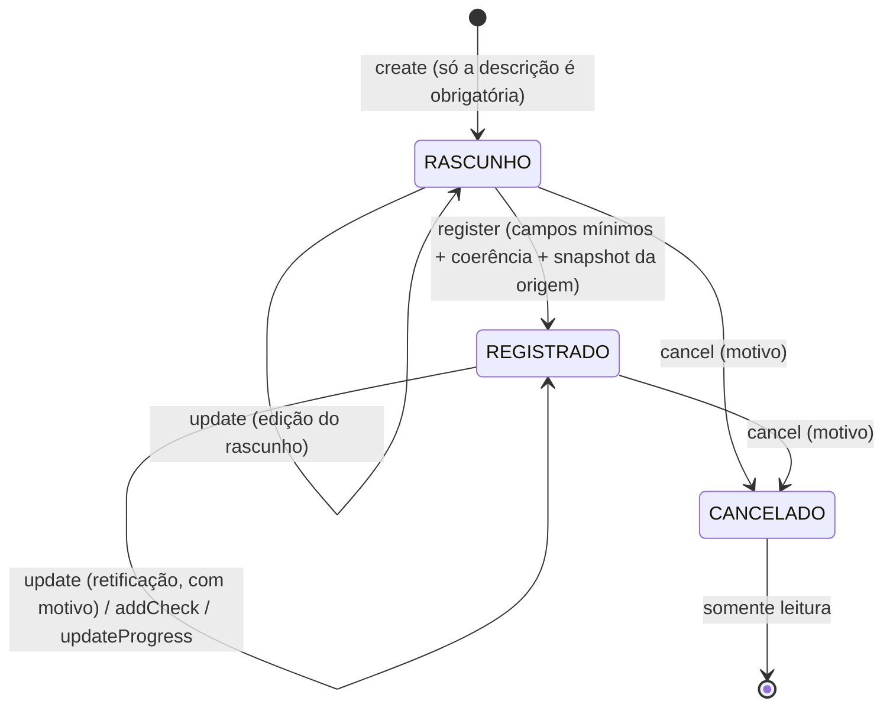

# Casos de uso e leituras das multas

<!-- fontes: src/Application/FineService.php src/Application/FineQuery.php -->

Registro **demonstrativo e manual** de infrações ([ADR-0017](../../../adr/0017-aba-multas.md)). `FineService` faz as
escritas (rascunho, edição/retificação, registro, conferência documental, andamento e cancelamento interno);
`FineQuery` faz as leituras (lista com resumos e ficha). **Nada aqui emite auto, consulta órgão, cobra ou protocola.**

Regras puras: [`FineRules` e `FineDocumentStatus`](../domain/multas.md). Rotas:
[`FineController`](../http/controladores.md#finecontroller). Guia: [Multas](../../../guias/multas.md).

## Garantias comuns a todas as escritas

Cada comando é **uma transação curta** que:

1. **Bloqueia a multa**, depois o equipamento, depois o agente (ordem fixa, evita impasse) — [`lockActive`](#fineservicelockactive) e [`lockSources`](#fineservicelocksources).
2. Confere a **versão** (`VERSION_NO`) que o formulário leu: diferente → `ConcurrencyConflict`
   ("O registro mudou depois que você abriu esta página…"). Toda mudança avança a versão.
3. Recusa registro `CANCELADO` (`RuleViolation`: "fica somente para consulta").
4. Grava a projeção em `FINE` e **um evento** em `FINE_EVENT` (só leitura e inserção para a aplicação), com resumo,
   motivo e antes/depois.
5. É **idempotente pela chave de comando** ([`once`](#fineserviceonce)): todo formulário leva `command_uid`
   (32 hexadecimais emitidos pelo servidor, diferente do CSRF). Reenvio idêntico (mesma chave, mesma conta, mesmos
   dados) devolve o resultado já gravado sem novo efeito; mesma chave com outra conta ou outros dados →
   `ConcurrencyConflict` ("Este formulário já foi usado para outra operação"), sem revelar o registro alheio.
6. Autoria: operação `MANUAL` exige conta; só a carga de demonstração (`SEMENTE`) grava sem autor
   ([`assertAuthor`](#fineserviceassertauthor)). Autoria, origem, estado e snapshot enviados no POST são ignorados.

## `FineService`

| Constante | Conteúdo |
|---|---|
| `CADASTRO` | campos do cadastro comparados no histórico (descrição, ocorrência, infração, órgão, AIT, local, relato, origem, radar/agente, velocidades, dados do medidor, evidência, veículo, RENAVAM…). `AGENT_ID` guarda o agente principal **ou** o operador associado ao radar. |
| `PROGRESS` | campos do andamento: etapa, pagamento, contestação, tipo, valor nominal, datas de expedição/recebimento/vencimento/prazos, pagamento, protocolo, resposta, encerramento. |
| `PROGRESS_LABELS` | rótulos do andamento (também usados nas mensagens). |
| `FACT_DATES` (privada) | datas de **fatos já ocorridos**: `autuation_issued_on`, `autuation_received_on`, `penalty_issued_on`, `penalty_received_on`, `paid_on`, `contest_submitted_on`, `contest_decided_on`, `closed_on` — não podem estar no futuro nem antes da ocorrência. Prazos e vencimentos podem. |
| `CORRECTIONS` (privada) | informações cuja **correção** exige motivo: pagamento (data, valor, comprovante), resposta da contestação e encerramento. |

### `FineService::create`

`create(array $data, ?int $actor, string $source = 'MANUAL'): int` — valida ([`validate`](#fineservicevalidate)),
calcula a impressão digital `CRIACAO` e, dentro de `once`: confere os recursos indicados, grava `RASCUNHO` com
`AIT_KEY`, `OCC_DOC_STATUS = NAO_VERIFICADA`, autoria/origem e `ATTENTION_COUNT`; evento `CRIACAO`. AIT repetido no
mesmo órgão (`UX_FINE_AIT`) → erro no campo AIT ("Abra o registro anterior em vez de criar outro").

### `FineService::update`

`update(int $id, array $data, ?int $actor, string $source = 'MANUAL'): void` — edição de rascunho **ou** retificação de
registro.

- Registrado exige `reason` (≤ 300) e precisa continuar com os campos mínimos, sem conflitos e com observação sobre a
  origem quando houver divergência ([`divergence`](#fineservicedivergence)).
- Nova data da ocorrência posterior a um **fato já anotado no andamento** → `ValidationFailed` em `occurred_at`
  nomeando as datas e dizendo até quando vale ([`assertFactsNotBefore`](#fineserviceassertfactsnotbefore)).
- Nada mudou → nenhum evento nem nova versão.
- Mudou algum campo de **identidade** (`FineRules::IDENTITY`: placa, UF, RENAVAM, marca, modelo, espécie, data/hora) →
  `SUBJECT_VERSION + 1` e a projeção documental é refeita para a nova identidade: a ficha volta a "Não verificada"
  até nova conferência; as conferências anteriores ficam no histórico.
- Registrado com origem, radar, agente ou órgão trocados → **snapshot novo** da origem; o anterior vai no evento.
- Evento `EDICAO_RASCUNHO` ou `RETIFICACAO` com até três campos no resumo ("e mais N campo(s)"), `alteracoes`, `antes`
  (retificação), `origem_anterior` e `sujeito {de, para}` quando couber.

### `FineService::register`

`register(int $id, array $data, ?int $actor, string $source = 'MANUAL'): void` — rascunho completo → `REGISTRADO`.
Dentro da transação, **com bloqueio**, reconfere se o radar ainda é radar e se o agente ainda é de trânsito, os campos
mínimos, as incoerências e as divergências; falta algo → `ValidationFailed` (a ficha lista cada item com link para o
campo). Grava `REGISTERED_AT` e o **snapshot da origem** ([`snapshot`](#fineservicesnapshot)): o cadastro atual do
radar ou do agente pode mudar depois sem reescrever o registro. Evento `REGISTRO` ("não é emissão de auto oficial").
Já registrado → `RuleViolation`.

### `FineService::addCheck`

`addCheck(int $id, array $data, ?int $actor, string $source = 'MANUAL'): void` — acrescenta uma **constatação
documental** (`FINE_DOCUMENT_CHECK`, imutável) e recalcula a situação na data da ocorrência.

| Campo | Regra |
|---|---|
| `scope` | `OCORRENCIA` (no dia da multa) ou `POSTERIOR` (depois) |
| `effective_on` | só em `POSTERIOR`: entre a data da ocorrência e hoje |
| `checked_at` | `datetime-local` de Marília; não futuro; não antes da data a que se refere |
| `document_status` | `NAO_VERIFICADA`, `REGULARIDADE_INFORMADA`, `PENDENCIA_INFORMADA` |
| `source_type` | fonte; com resultado, não pode ser `NAO_INFORMADA` |
| `source_reference` | ≤ 240; obrigatória com resultado ("sem dados pessoais") |
| `crlv_exercise` | opcional, 1990 até o ano seguinte |
| `pending_items` | ≤ 500; obrigatório em pendência (descartado nos outros resultados) |
| `check_reason` | ≤ 300; obrigatório para "Não verificada" (ex.: retirar uma conclusão anterior) |
| `review_choice` + `review_on` | lembrete ([`FineDocumentStatus::reviewOn`](../domain/multas.md#finedocumentstatusreviewon)); não pode ser antes da data a que se refere |

Exige data da ocorrência no cadastro. Grava a constatação com a **versão do sujeito** atual, atualiza `OCC_DOC_STATUS`,
`DOC_REVIEW_ON`, `DOC_REVIEW_SCOPE` (o lembrete da conferência anotada por último) e `ATTENTION_COUNT`; evento
`CONFERENCIA_DOCUMENTAL` com a situação na ocorrência antes/depois. Uma regularidade posterior aparece separada e
**não corrige** a ocorrência.

### `FineService::updateProgress`

`updateProgress(int $id, array $data, ?int $actor, string $source = 'MANUAL'): list<string>` — andamento informado à
mão; devolve **avisos** ([`FineRules::progressWarnings`](../domain/multas.md#finerulesprogresswarnings)).

- Etapa, pagamento e contestação são **independentes** (pagamento informado e recurso em análise podem coexistir).
- Valores em reais (`1.234,56`) viram centavos ([`Input::cents`](validacao-e-filtros.md#input)): nominal 0–1.000.000,00;
  pago 0,01–1.000.000,00.
- Condicionais: pagamento informado exige data, valor e comprovante; contestação apresentada exige tipo, data de
  protocolo e número; resultado (deferida/indeferida) exige data e o que o órgão respondeu; encerramento exige data,
  documento e como terminou ("o sistema não conclui procedência").
- Datas de fatos não futuras e não antes da ocorrência; recebimento antes da expedição ou resultado antes do protocolo
  → erro.
- Corrigir pagamento, resultado ou encerramento **já informados** exige `progress_reason` (a anterior fica no
  histórico). Sem mudança → nenhum evento.
- Nada é calculado: prazos, descontos e decisões são só transcritos.

### `FineService::cancel`

`cancel(int $id, array $data, ?int $actor, string $source = 'MANUAL'): void` — cancelamento **interno** (engano,
duplicidade): `CANCELADO`, `CANCELLED_AT/BY`, origem, motivo (1–300), `ATTENTION_COUNT = 0`; evento `CANCELAMENTO`. Não
é anulação do auto nem decisão oficial e não mexe em pagamento ou contestação. O registro fica somente leitura.

### `FineService::validate`

`private validate(Input $in): array` — campos do cadastro validados e normalizados. Rascunho aceita ausências; o que
vier precisa estar bem formado.

- `description` 5–240 (sempre obrigatória); `occurred_at` não futura; latitude e longitude juntas ou nenhuma.
- Placa normalizada e no formato (`AAA1234`/`AAA1A23`). **Origem Radar sem placa → erro mesmo em rascunho** (sem placa
  legível o radar não gera registro).
- RENAVAM: texto de **11 dígitos, zeros à esquerda preservados**, nada é completado; informado → justificativa de
  ausência descartada. AIT informado → justificativa de ausência descartada.
- Origem: sem origem, indicar radar/agente é erro; `AGENTE` recusa radar e operador; `RADAR` recusa agente principal e
  usa o operador em `agent_id`. Fora de `RADAR`, dados do medidor e evidência são descartados.
- Velocidades só em `VELOCIDADE` (descartadas nos outros tipos); a **considerada é sempre recalculada**
  ([`FineRules::consideredSpeed`](../domain/multas.md#métodos)); o valor enviado é ignorado.
- Órgão e bairro precisam existir.

### `FineService::lockSources`

`private lockSources(array $f): array{0: ?array, 1: ?array}` — bloqueia o equipamento e depois o agente indicados e
confere o tipo (FK não garante que o equipamento é radar nem que o agente é de trânsito): "Radar inexistente.", "O
equipamento escolhido não é um radar.", "Escolha um agente de trânsito…". Arquivamento, pausa ou manutenção atuais
**não** bloqueiam um registro histórico.

### `FineService::divergence`

`private divergence(array $f, ?array $equipment, ?array $agent): array` — divergências com o cadastro da origem
exigem **observação sobre a origem** (`source_note`), não são proibidas nem conclusão de validade: órgão autuador
diferente do órgão do recurso; radar sem a função da infração entre as cadastradas; radar nunca instalado (não
instalado e sem data); radar `FIXO` com agente operador. O cadastro pode ter mudado desde o fato, por isso a
explicação basta. Com `source_note` preenchida, nada é exigido.

### `FineService::snapshot`

`private snapshot(array $f, ?array $equipment, ?array $agent): array` — retrato montado só pelo servidor: instante,
origem, órgão autuador e, conforme o caso, radar (código, fabricante, modelo, série, órgão, funções, limite
cadastrado, modalidade, situação, arquivado) e agente (código, indicativo, função, órgão, papel: "operador associado"
ou "agente da constatação", arquivado).

### `FineService::once`

`private once(string $uid, string $hash, ?int $actor, callable $work): mixed` — se já existe evento com a chave, devolve
o resultado gravado (ou conflito se conta/dados diferem). Senão executa; se a execução falhar com
`ConstraintViolation`, `ValidationFailed`, `ConcurrencyConflict` ou `RuleViolation` e **agora** existir evento da mesma
chave, outra requisição com a mesma chave terminou primeiro (a corrida pode aparecer como chave de evento, AIT
repetido, versão avançada ou registro já cancelado): esta foi desfeita por inteiro e vale o resultado gravado. Sem
evento da chave, o erro é desta requisição.

### `FineService::lockActive`

`private lockActive(int $id, int $version): array` — bloqueia; inexistente → `NotFound`; cancelado → `RuleViolation`;
versão diferente → `ConcurrencyConflict`.

### `FineService::assertFactsNotBefore`

`private static assertFactsNotBefore(array $f, string $occurredAt): void` — mesma regra do andamento: fatos já
anotados não podem ficar antes da nova data da ocorrência. Nada é ajustado em silêncio: a retificação é recusada com a
lista ("aviso de infração enviado em DD/MM/AAAA; …") e a orientação "Use uma data até … ou corrija antes a situação da
multa".

### `FineService::assertAuthor`

`private static assertAuthor(?int $actor, string $source): void` — só `MANUAL` (com conta) ou `SEMENTE`; caso
contrário `LogicException`.

| Método | Contrato |
|---|---|
| `FineService::__construct` | `(Database, FineRepository, ReferenceRepository, EquipmentRepository, AgentRepository, Clock)`. |
| `FineService::newCommandUid` | `static (): string` — 16 bytes aleatórios em hexadecimal (32 caracteres), sem dado pessoal; o controlador emite um por formulário e o mantém ao reapresentar. |
| `FineService::formValues` | `static (array $fine): array` — cadastro gravado → nomes do formulário: data/hora local (`AAAA-MM-DDTHH:MM`), operador do radar em `operator_agent_id`, dados do medidor em `radar_*`. |
| `FineService::pendingChanges` | `(int $id, array $data): array` — diferenças para a tela de conflito; dados inválidos → `[]`. |
| `FineService::projection` | `private (int $id, int $subjectVersion): array` — `OCC_DOC_STATUS` (conferência que vale na ocorrência), `DOC_REVIEW_ON` e `DOC_REVIEW_SCOPE` (lembrete em vigor). |
| `FineService::laterStatus` | `private (int $id, int $subjectVersion): ?string` — resultado da última conferência "depois da multa" da identidade atual (entra na regra da pendência regularizada). |
| `FineService::event` | `private (...)` — grava `FINE_EVENT` (chave, impressão digital, tipo, origem, ator, instante, resumo, motivo, payload). |
| `FineService::persist` | `private (callable $write): mixed` — `UX_FINE_AIT` → erro no AIT. |
| `FineService::uid` | `private static (Input $input): string` — `command_uid` com 32 hex, senão erro "Formulário incompleto ou expirado: recarregue a página." |
| `FineService::fingerprint` | `private static (string $operation, int $target, int $version, ?int $actor, array $values): string` — SHA-256 do JSON de operação, alvo, versão, ator e dados normalizados com chaves ordenadas (recursivo). |
| `FineService::now` | `private (): string` — agora em UTC para o banco. |
| `FineService::fieldList` | `private static (array $labels): string` — até três nomes e "e mais N campo(s)". |
| `FineService::br` | `private static (string $date): string` — data brasileira. |

Concorrência e idempotência comprovadas: `FinesTest` (processos concorrentes, rollback por falha no histórico,
retificação × fatos do andamento, lembretes, nova identidade, v1 → v3 sem duplicar), `FinesHttpTest` (reenvio, 409 com
digitação mantida).

## `FineQuery`

Leituras da aba Multas, cada tela num único instante do banco (transação **SNAPSHOT** somente leitura).

| Símbolo | Contrato |
|---|---|
| `FineQuery::PER_PAGE` | 20 por página na lista |
| `FineQuery::EVENTS_PER_PAGE` | 20 eventos por página na ficha |
| `FineQuery::__construct` | `(Database, FineRepository, EquipmentRepository, AgentRepository, Clock)`. |
| `FineQuery::list` | `(FineFilters $filters, int $page): array{rows, total, attention, paid, page, pages}` — página da lista, total e os resumos "a conferir" e "pagas" **do mesmo filtro e do mesmo instante**; cada linha recebe `attention` com o dia local de hoje. |
| `FineQuery::detail` | `(int $id, int $eventsPage): ?array` — ficha: cadastro (`f`), conferência que vale na ocorrência e a posterior (versão atual do sujeito), todas as conferências (inclusive de identidades anteriores, marcadas na tela), histórico paginado, motivos de "a conferir", pendências para registrar (rascunho) e o **cadastro atual** do radar e do agente, para comparar com o snapshot gravado. `null` se não existe. |

## Relacionados

[Repositório de multas](../infrastructure/repositorios-multas.md) · [Filtros](validacao-e-filtros.md#finefilters) ·
[HTTP: multas](../../../http.md#multas) · [Cenário de demonstração das multas](../demo/multas-de-demonstracao.md)
