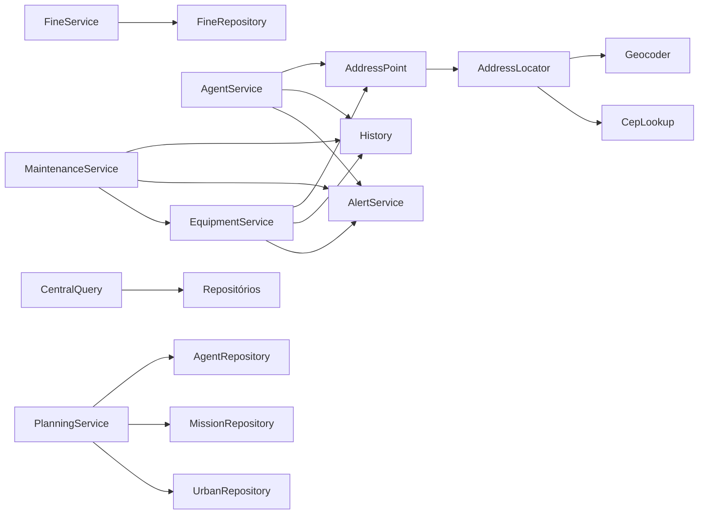

# Configuração, raiz de composição e pontos de entrada

<!-- fontes: src/Config.php src/Services.php public/index.php bin/fiscaliza -->

Como o processo nasce: os pontos de entrada (`public/index.php` para a web, `bin/fiscaliza` para a CLI) carregam a
configuração ([`Config`](#config)), descartam as credenciais que aquele processo não pode ter e montam a raiz de
composição ([`Services`](#services)), que cria cada objeto uma vez, sob demanda.

## Pontos de entrada

| Arquivo | Papel | Credenciais |
|---|---|---|
| `public/index.php` | Front controller, única porta HTTP. Carrega o autoload do Composer, `Config::load(raiz)->without(Config::PRIVILEGED)`, cria `Services` e executa [`WebApp::create($services)->run()`](../http/aplicacao-web.md#webappcreate). | Só `DB_USER`/`DB_PASSWORD`; as do dono do esquema e do SYSDBA são removidas antes de criar qualquer objeto. |
| `bin/fiscaliza` | Entrada da CLI (shebang `php`). Recusa rodar fora de `PHP_SAPI === 'cli'` (sai com 1). Lê os argumentos, carrega a configuração e, **exceto** para `migrate`, `demo:seed` e `demo:seed-multas`, remove `Config::PRIVILEGED`. Sai com o código de [`Console::run`](../cli/console.md#consolerun). | Dono do esquema só nos três comandos citados. |

Nada de `bin/` é acessível por HTTP: o Apache serve só `public/` ([docker/php](../../../../docker/README.md)).

## `Config`

Configuração vinda do ambiente. Um `.env` opcional (formato `CHAVE=valor`) é lido e, **por cima**, as variáveis reais
do processo — estas vencem. Funciona no Compose e em hospedagem sem variáveis de ambiente.

| Símbolo | Contrato |
|---|---|
| `Config::PRIVILEGED` | `['DB_MIGRATION_USER', 'DB_MIGRATION_PASSWORD', 'FIREBIRD_ROOT_PASSWORD']` — credenciais só para migração e carga. |
| `Config::__construct` | `(array $values)` — mapa já resolvido. |
| `Config::load` | `static (string $projectRoot): self` — `.env` da raiz (se existir) + `getenv()` por cima. |
| `Config::parseDotEnv` | `static (string $contents): array<string, string>` — ignora linhas vazias, `#` e sem `=`; aceita valor entre aspas simples ou duplas; sem aspas, remove comentário final `  # …`. Não interpola variáveis. |
| `Config::with` | `(array $overrides): self` — cópia com valores sobrepostos (ex.: `--perfil` do `demo:seed`). |
| `Config::without` | `(array $keys): self` — cópia sem as chaves (descarte de credenciais). |
| `Config::get` | `(string $key, string $default = ''): string`. |
| `Config::require` | `(string $key): string` — vazio ou ausente → `RuntimeException` "Variável de ambiente obrigatória ausente: CHAVE". |
| `Config::bool` | `(string $key, bool $default = false): bool` — `FILTER_VALIDATE_BOOL` (`true`, `1`, `on`, `yes`…). |
| `Config::int` | `(string $key, int $default): int` — inteiro válido ou o padrão. |
| `Config::environment` | `(): string` — `APP_ENV`, padrão `production`. |
| `Config::isProduction` | `(): bool` — liga cache de templates e desliga `strict_variables` do Twig. |
| `Config::basePath` | `(): string` — `APP_BASE_PATH` sem barra final (ex.: `/promotheusfiscaliza`; vazio = raiz). Precisa casar `^(/[A-Za-z0-9._-]+)+$`, senão `RuntimeException`. |
| `Config::cepLookupUrl` | `(): string` — `CEP_LOOKUP_URL` ou `https://viacep.com.br/ws`. |
| `Config::geocoderUrl` | `(): string` — `GEOCODER_URL` ou `https://nominatim.openstreetmap.org`. |
| `Config::httpsUrl` | `private (string $key, string $default): string` — exige `https://host[:porta][/caminho]` sem query; senão `RuntimeException` "CHAVE inválido". |

Lista completa das variáveis, padrões e quem as lê: [operação: configuração](../../../operacao.md#configuração-env-ou-variáveis-de-ambiente).
Teste: `ViewCacheTest` (produção × desenvolvimento), `CepLookupTest` (URLs).

## `Services`

Raiz de composição. Cada método devolve o objeto pronto, criado **uma vez** por instância (`shared()`); os construtores
recebem tudo explicitamente (sem contêiner mágico). A web usa a identidade da aplicação (somente DML); migrações e
carga usam a identidade de migração.

| Símbolo | Contrato |
|---|---|
| `Services::__construct` | `(Config $config, string $root, ?Database $database = null, ?Clock $clock = null, ?CepLookup $cepLookup = null, ?Geocoder $geocoder = null)` — `config` e `root` públicos. |
| `Services::asMigrationIdentity` | `(): self` — mesmos serviços conectados como **dono do esquema** (`DB_MIGRATION_*`, timeout 60 s). Usado por `migrate`, `demo:seed`, `demo:seed-multas`, testes e `avaliar-sementes.php`. |
| `Services::withClock` | `(Clock $clock): self` — troca o relógio (testes, carga). |
| `Services::withCepLookup` | `(CepLookup $lookup): self` — troca o provedor de CEP (testes usam `FakeCepLookup`; nenhum teste usa a rede). |
| `Services::withGeocoder` | `(Geocoder $geocoder): self` — idem para a localização (`FakeGeocoder`). |
| `Services::cepLookup` | `(): CepLookup` — `ViaCepClient(Config::cepLookupUrl())`, criado só quando algo consulta um CEP. |
| `Services::geocoder` | `(): Geocoder` — `NominatimGeocoder(Config::geocoderUrl())`, sob demanda. |
| `Services::addressPoint` | `(): AddressPoint` — recebe o localizador como *closure* (só é criado se precisar consultar). |
| `Services::addressLocator` | `(): AddressLocator`. |
| `Services::clock` | `(): Clock` — relógio do sistema, salvo injeção. |
| `Services::database` | `(): Database` — `DB_DSN`, `DB_USER`, `DB_PASSWORD` (obrigatórios) e `DB_STATEMENT_TIMEOUT_SECONDS` (padrão 5). |
| `Services::migrationDatabase` | `(): Database` — `DB_DSN`, `DB_MIGRATION_USER`, `DB_MIGRATION_PASSWORD`, timeout 60 s. |
| `Services::migrator` | `(): Migrator` — sobre `database/migrations` com a identidade de migração. |
| `Services::equipmentRepository` … `Services::fineRepository` | Repositórios: `equipmentRepository`, `agentRepository`, `maintenanceRepository`, `eventRepository`, `alertRepository`, `referenceRepository`, `userRepository`, `metaRepository`, `analysisRepository`, `urbanRepository`, `missionRepository`, `fineRepository` — todos sobre `database()`. |
| `Services::fines` | `(): FineService`. |
| `Services::fineQuery` | `(): FineQuery`. |
| `Services::history` | `(): History`. |
| `Services::alerts` | `(): AlertService`. |
| `Services::equipment` | `(): EquipmentService`. |
| `Services::agents` | `(): AgentService`. |
| `Services::maintenance` | `(): MaintenanceService` (depende de `equipment()` para aplicar a situação). |
| `Services::ingestor` | `(): EventIngestor`. |
| `Services::central` | `(): CentralQuery` — recebe `SIM_INTERVAL_SECONDS` (padrão 5) para decidir se o simulador está ativo. |
| `Services::auth` | `(): AuthService`. |
| `Services::analysis` | `(): AnalysisService`. |
| `Services::urbanImporter` | `(): UrbanImporter` — instância nova a cada chamada. |
| `Services::urbanUpdater` | `(): UrbanUpdater` — instância nova a cada chamada. |
| `Services::planning` | `(): PlanningService`. |
| `Services::seeder` | `(): DemoSeeder` — semente `SIM_SEED` (padrão 2026) e perfil `DEMO_PROFILE` (padrão compacto; inválido → `InvalidArgumentException`). |
| `Services::simulator` | `(): Simulator` — semente `SIM_SEED`. |
| `Services::shared` | `private (string $key, callable $factory): object` — memoização por chave. |

Os repositórios individuais seguem o mesmo padrão: `Services::agentRepository`, `Services::maintenanceRepository`,
`Services::eventRepository`, `Services::alertRepository`, `Services::referenceRepository`, `Services::userRepository`,
`Services::metaRepository`, `Services::analysisRepository`, `Services::urbanRepository`, `Services::missionRepository`.

Dependências entre serviços (o que cada construtor recebe):

## Relacionados

[Arquitetura](../../../arquitetura.md) · [Operação: credenciais por processo](../../../operacao.md#credenciais-por-processo) ·
[`src/README.md`](../../../../src/README.md)
